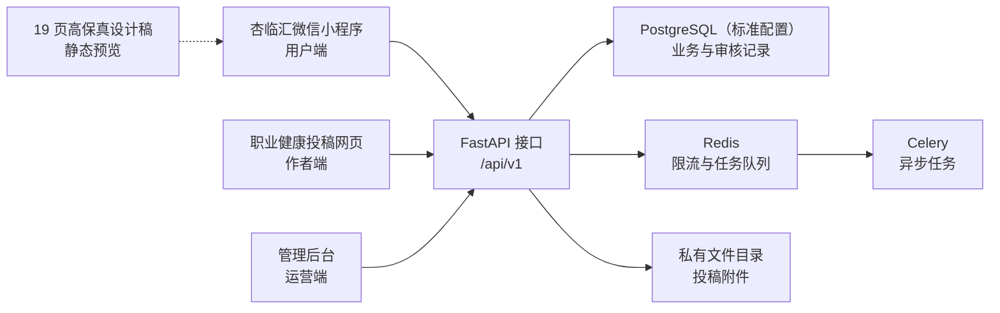

# 杏临汇项目架构与前端界面概览

> 内部汇报版 · 2026 年 9 月 29 日。依据当前代码与页面文件盘点；“已有页面”表示仓库中存在相应实现，不等于已经对外开放或完成真实业务验收。

## 一、项目怎么组成

项目有三套实际前端：面向用户的微信小程序、面向职业健康作品作者的投稿网页、面向运营人员的管理后台。三端通过同一套 FastAPI 接口处理业务记录；标准配置使用 PostgreSQL 保存业务与审核数据，Redis 支持限流和异步任务，投稿附件存放在后端私有目录。本机开发也可使用 SQLite。另有一套小程序高保真设计稿，供审阅界面使用。

## 二、前端界面与当前范围

| 前端 | 给谁用、能看到什么 | 当前业务边界 |
|---|---|---|
| **杏临汇小程序** `miniprogram/` | 原生微信小程序，注册 19 个页面；底部为“首页、管家、商城、我的”四个入口。覆盖九类健康需求场景、服务与人员资料、预约、咨询、药品展厅、档案和个人信息。 | 服务与人员资料可展示；人员资质未形成核验闭环。预约和系统会话只供开发测试演示，预发布及生产环境关闭新增预约与咨询。商城仍为浏览骨架；健康档案在正式环境暂停新增、修改。药品展厅按发布状态过滤，开发测试环境的演示资料须明确标识。 |
| **职业健康投稿网页** `essay-h5/` | 手机和桌面浏览器访问；当前只有活动首页 `/` 与投稿页 `/submit` 两条业务路由。介绍职业健康科普作品征集、图文 `.docx` 与视频 `.mp4` 要求，填写作者信息并上传文件。 | 投稿接口具有文件校验、私有存储和回执链路；仅服务器生成有效回执才显示成功。投稿开关默认关闭，页面会显示开放、关闭或状态获取失败；评审安排不等于投稿截止日期。旧文学活动网页入口已下线，历史数据保留。 |
| **运营管理后台** `admin-web/` | 登录后进入工作台，按权限显示“职业健康投稿”、健康预约、在线咨询、专业人员、药品展厅、服务与商城、审计日志。 | 可按权限查看投稿、下载私有附件、记录材料审核状态；该状态不代表获奖、公众号收录或证书发放。健康概览统计的是数据库记录，不代表真实诊疗量。服务和公告可管理；商城商品目前只可预览。 |
| **小程序高保真稿** `design/杏临汇小程序-高保真-2026-09-24/` | `预览.html` 可浏览 19 张独立 PNG；`index.html` 是可在浏览器查看单页的静态 HTML/CSS/JS 设计源。 | 与小程序 19 条真实路由对应，供界面审阅和开发交接；不连接业务接口，也不能作为小程序功能上线的证据。 |

**审阅入口：**小程序在微信开发者工具中导入 `miniprogram/`；两套网页在本地服务启动后分别访问管理后台 `localhost:5173`、作者网页 `localhost:5174`；设计稿可直接打开[19 页预览](../design/杏临汇小程序-高保真-2026-09-24/预览.html)。这些是本机审阅方式，并非公网访问地址。

## 三、接口与数据如何流转

1. **小程序 → 健康服务接口。** 首页、场景、服务、人员、药品等页面读取 `/api/v1/mp/*`；登录走微信相关接口。预约、咨询、档案写入受环境开关约束，演示记录不能计作真实服务完成。
2. **作者网页 → 投稿接口。** 网页先读取 `/api/v1/h5/occupational-submissions/meta` 确认通道状态，再提交表单和文件。后端校验作品、保存私有文件及数据库记录，返回回执号。作者网页不公开投稿附件与联系电话。
3. **管理后台 → 授权接口。** 后台使用 `/api/v1/admin/*` 查看统计和业务记录；职业健康作品的详情、下载、审核由服务端权限控制并留下审计记录。前端的菜单隐藏只是辅助显示，最终权限以服务端为准。

## 四、本轮界面改版与验收口径

本轮网页界面改版集中在 **职业健康投稿网页** 和 **运营管理后台**：重新设计职业健康征集首页、投稿表单和手机布局；后台梳理工作台、导航、统计展示、列表、弹窗和窄屏布局。原生小程序和其 19 页设计稿在此作为前端现状盘点，不能用网页改版结果代替小程序验收。

这份概览完成的是**源码与页面范围核对**；本轮两套网页还完成了静态构建及本机浏览器检查。本机预览使用 SQLite 演示副本，统计卡数字仅反映该副本记录。代码存在、静态构建通过、浏览器实际操作、小程序模拟器、实体手机、预发布联调和公网开放是不同层级的证据。对领导汇报时，只有拿到对应环境的真实操作记录，才能将“可演示”提升为“已验收”；统计卡里的条目数也不能解读为服务效果。

## 五、尚未接通与上线前待确认

- **健康服务：**真实排班与预约、真人咨询接管、专业人员资质核验、AI 健康问答，以及商城交易等流程尚未形成可对外承诺的闭环。
- **作品征集：**正式投稿起止时间、主办主体与隐私文案、作品公开展示授权、通知与证书流程、七区复评执行方式仍需主办方确认；现有后台“材料审核通过”仅为内部处理状态。
- **部署验收：**正式域名和 HTTPS、文件容量及备份、安全扫描、预发布环境中“投稿—审核—下载”的完整联调及对外开放决定，须另有验收记录。现有设计稿、本地代码和构建产物均不能替代这些记录。

## 附录：核对依据

| 事项 | 关键源码或文档 |
|---|---|
| 总体目录与开发环境 | [README.md](../README.md) 第 1–32、75–83 行；[docker-compose.yml](../docker-compose.yml) 第 1–32 行 |
| 小程序页面、四个入口与九类场景 | [miniprogram/app.json](../miniprogram/app.json) 第 2–52 行；[miniprogram/utils/config.js](../miniprogram/utils/config.js) 第 9–20 行 |
| 小程序真实服务门禁 | [预约接口](../backend/app/api/mp/appointments.py) 第 65–75 行；[咨询接口](../backend/app/api/mp/consults.py) 第 41–56 行；[档案接口](../backend/app/api/mp/profile.py) 第 24–58 行；[药品接口](../backend/app/api/mp/drugs.py) 第 26–35 行 |
| 作者网页路由、投稿开关与回执 | [essay-h5/src/App.tsx](../essay-h5/src/App.tsx) 第 58–70 行；[投稿页面](../essay-h5/src/pages/OccupationalSubmitPage.tsx) 第 97–108、151–170、198–209、314–317 行；[投稿接口](../backend/app/api/h5/occupational_submissions.py) 第 120–159、198–252 行 |
| 后台模块、权限与统计口径 | [admin-web/src/App.tsx](../admin-web/src/App.tsx) 第 24–46 行；[导航](../admin-web/src/components/layout/AdminLayout.tsx) 第 30–65 行；[权限](../admin-web/src/lib/permissions.ts) 第 1–30 行；[健康统计接口](../backend/app/api/admin/mp.py) 第 71–98 行；[服务与商品页面](../admin-web/src/pages/MpServices.tsx) 第 510–516 行 |
| 服务端、任务与附件隔离 | [后端入口](../backend/app/main.py) 第 40–77、98–113 行；[路由汇总](../backend/app/api/__init__.py) 第 21–42 行；[Celery 配置](../backend/app/workers/celery_app.py) 第 1–27 行；[私有投稿目录](../backend/app/services/occupational_submission_service.py) 第 54–59 行 |
| 高保真稿的定位 | [设计说明](../design/杏临汇小程序-高保真-2026-09-24/设计说明.md) 第 1–5、13–27 行；[19 页预览](../design/杏临汇小程序-高保真-2026-09-24/预览.html) 第 14–26 行 |
| 活动与上线待决策项 | [职业健康征集系统计划](2026职业健康科普作品征集-系统改造与上线计划.md) 第 22–48 行 |
